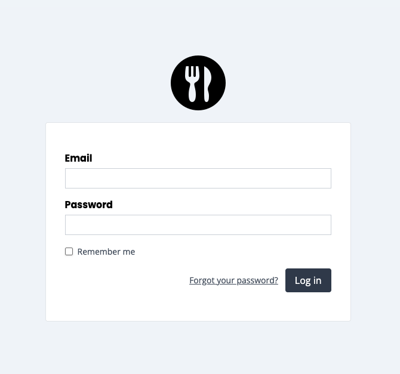

## Laraauth

## Table of Contents
- [About](#About)
- [Installation](#Installation)
- [Name](#Name)
- [Login](#Login)
- [Logout](#Logout)
- [Registration](#Registration)
- [Verify Email](#Verify-Email)
- [Forgot Password](#Forgot-Password)
- [Confirm Password](#Confirm-Password)
- [Show Site Logo](#Show-Site-Logo)
- [Filter Registration Rules](#Filter-Registration-Rules)
- [Filter Registration Attributes](#Filter-Registration-Attributes)
- [Custom Styling](#Custom-Styling)

## About

Laraauth is an authentication package for Laravel.



## Installation

Install with `composer require njdigitallab/laraauth`.

## Getting Started

Publish the package assets by running `php artisan vendor:publish --tag=laraauth-assets`.

## Name

By default, laravel user migration comes with the name column only. If you want to work with first and last name instead, take the following steps:

- Publish the package migration file with `php artisan vendor:publish --tag=laraauth-migrations` then run the `php artisan migrate` command. Alternatively, You can edit the default laravel user migration file and ignore this step.

- In your `AppServiceProvider` boot method, call Laraauth `allowFirstAndLastName` method. This tells the package that we will be working with first and last name instead of name only.

```php
use NjDigitalLab\Laraauth\Laraauth;

/**
 * Bootstrap any application services.
 */
public function boot(): void
{
    Laraauth::allowFirstAndLastName();
}
```

- Update the fillable attributes on the User model.

```php
// If using attributes
#[Fillable(['first_name', 'last_name', 'email', 'password'])]

// If defining on the model
protected $fillable = [
    'first_name', 'last_name', 'email', 'password',
];
```

## Login

Login is available at `/login` url and needs no configuration.

## Logout

To logout, send a post request to the logout route.

```php

<a href="" class="" onclick="event.preventDefault(); document.getElementById('logout-form').submit();">
    Logout
</a>
<form method="POST" style="display: hidden;" action="{{ route('logout') }}">
    @csrf
</form>
```

## Registration

Registration is available at `/register` url.

You can disable registration by calling the Laraauth `disableRegistration` method in your `AppServiceProvider` register method.

```php
use NjDigitalLab\Laraauth\Laraauth;

/**
 * Register any application services.
 */
public function register(): void
{
    Laraauth::disableRegistration();
}
```

If you are using first name and last name for registration, refer to the [Name](#Name) section.

## Verify Email

Verify email works as per the Laravel default configuration. Apply the `verified` middleware to the respective route and implement the `Illuminate\Contracts\Auth\MustVerifyEmail` contract on the User model.

## Forgot Password

Forgot password is available at `/forgot-password` url and need no configuration.

## Confirm Password

Confirm password works as per the Laravel default configuration. Apply the `password.confirm` middleware to the respective route.

## Show Site Logo

If you prefer to show a logo instead of the site name, call the Laraauth `showLogo` method in your `AppServiceProvider` boot method and pass the full url to the image file you wish to use.

```php
use NjDigitalLab\Laraauth\Laraauth;

/**
 * Bootstrap any application services.
 */
public function boot(): void
{
    Laraauth::showLogo(asset('images/logo.png'));
}
```

## Filter Registration Rules

You can filter registration rules by calling the `Laraauth::filterRegistrationValidationRules()` method in your AppServiceProvider register method. It accepts a closure as it's only argument. The current rules array and request object is passed to the closure as arguments.

```php
use NjDigitalLab\Laraauth\Laraauth;

/**
 * Register any application services.
 */
public function register(): void
{
    Laraauth::filterRegistrationValidationRules(function ($rules, $request) {
        // Filter rules....

        return $rules;
    });
}
```

### Filter Registration Attributes

You can filter the registration attributes by calling the `Laraauth::filterRegistrationAttributes()` method in your AppServiceProvider register method. It accepts a closure as it's only argument. The current attributes array and request object is passed to the closure as arguments.

```php
use NjDigitalLab\Laraauth\Laraauth;

/**
 * Register any application services.
 */
public function register(): void
{
    Laraauth::filterRegistrationAttributes(function ($attributes, $request) {
        // Filter attributes....
        $attributes['name'] = 'Some Name';

        return $attributes;
    });
}
```

## Custom Styling

If you want to use your own styling, you can disable the default stylesheet by adding `Laraauth::disableStylesheet()` to your AppServiceProvider register method.

```php
use NjDigitalLab\Laraauth\Laraauth;

/**
 * Register any application services.
 */
public function register(): void
{
    Laraauth::disableStylesheet();
}
```
